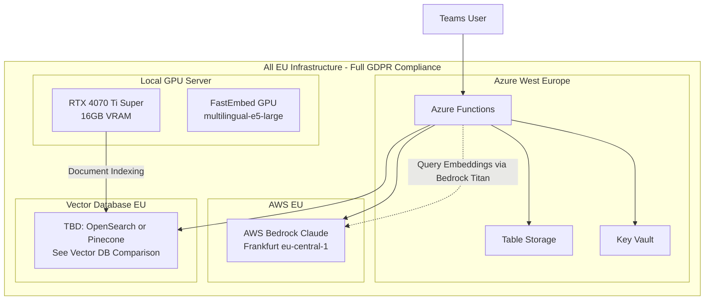

# Migration Plan: EU/GDPR-Compliant Infrastructure

Migrate RAGStone to fully EU-compliant infrastructure: AWS Bedrock Claude (Frankfurt) for LLM, local GPU embeddings (multilingual-e5-large) for document indexing, and EU-based vector storage -- achieving complete GDPR compliance with zero embedding API costs.

## Current State vs Target

| Component | Before (US) | After (EU) |
|---|---|---|
| LLM | OpenAI API (US) | AWS Bedrock Claude (Frankfurt `eu-central-1`) |
| Embeddings (indexing) | OpenAI `text-embedding-3-small` (US, 1536 dims) | Local GPU `multilingual-e5-large` (1024 dims) |
| Embeddings (query) | OpenAI `text-embedding-3-small` (US, 1536 dims) | AWS Bedrock Titan V2 (Frankfurt, 1024 dims) |
| Vector DB | Pinecone US (`us-east-1`) | TBD -- see [Vector DB Comparison](../../pinecone-pipeline/docs/VECTOR-DB-COMPARISON.md) |

**Interim (2026):** Full Ireland/Bedrock/OpenSearch migration is deferred pending AWS architecture review. The stack continues with Pinecone (index `text-embedding-3-small`, pipeline namespaces `PINECONE_NAMESPACE_DEV` / `PINECONE_NAMESPACE_PROD` e.g. `v3` and `production`), OpenAI `text-embedding-3-small` (1536-dim), and a Dockerized indexing pipeline — see [`pinecone-pipeline/README.md`](../../pinecone-pipeline/README.md).

## Key Changes

- Replace `ChatOpenAI` with `ChatBedrock` from `langchain_aws`
- Replace OpenAI embeddings with FastEmbed GPU (local `multilingual-e5-large`)
- Change vector index dimension from 1536 to 1024 (`multilingual-e5-large` output)
- Use AWS Bedrock Titan V2 for query-time embeddings (1024 dims, EU-compliant)
- Add AWS credentials to Azure Key Vault
- Update Terraform for AWS secrets and environment variables
- Re-index all documents with new embeddings

## Key Benefits

- **Full EU GDPR Compliance:** All data processing stays in EU (Ireland, Frankfurt, local GPU)
- **Zero Embedding API Costs:** Local GPU eliminates embedding API fees (~$5/mo savings)
- **2-3x Faster Embeddings:** GPU processing (~10-20s) vs API (~30-60s) for ~1,500 chunks
- **No API Rate Limits:** Process unlimited documents locally
- **Same LLM Quality:** Claude 3.7 Sonnet matches GPT-4o performance

---

## Architecture



---

## Implementation Steps

### Phase 0: Local GPU Setup (Embeddings)

**0.1 Install CUDA and CuDNN**

- Install CUDA 12.x toolkit (or CUDA 11.8)
- Install CuDNN 9.x library
- Verify GPU detection: `nvidia-smi`
- Set environment variables if needed (LD_LIBRARY_PATH)

**0.2 Install FastEmbed GPU**

File: `pinecone-pipeline/pyproject.toml` or create `requirements-gpu.txt`

```toml
fastembed-gpu>=0.7.0
onnxruntime-gpu>=1.19.0
```

Install:

```bash
pip uninstall fastembed  # Remove CPU version if installed
pip install fastembed-gpu
```

**0.3 Test GPU Embeddings**

```python
from fastembed import TextEmbedding

embedding_model = TextEmbedding(
    model_name="intfloat/multilingual-e5-large",
    cache_dir="./models"
)

texts = ["Test document chunk"]
embeddings = list(embedding_model.embed(texts))
print(f"Embedding dimension: {len(embeddings[0])}")  # Should be 1024
```

**Expected Performance:**

- Model loading: ~2-5 seconds (first time, cached after)
- Embedding speed: ~200-500 chunks/second
- VRAM usage: ~3-4 GB

---

### Phase 1: AWS Bedrock Setup

**1.1 Create AWS Account Resources (Manual)**

- Create AWS account or use existing
- Enable Bedrock in `eu-central-1` (Frankfurt) region
- Request model access for Claude models:
  - `anthropic.claude-3-7-sonnet-20250219-v1:0`
  - `anthropic.claude-3-5-sonnet-20241022-v2:0` (fallback)
- Create IAM user `ragstone-bedrock-access` with policy:

```json
{
  "Version": "2012-10-17",
  "Statement": [{
    "Effect": "Allow",
    "Action": [
      "bedrock:InvokeModel",
      "bedrock:InvokeModelWithResponseStream"
    ],
    "Resource": "arn:aws:bedrock:eu-central-1::foundation-model/anthropic.*"
  }]
}
```

- Generate access key pair, store securely

**1.2 Update Terraform for AWS Secrets**

File: `infrastructure/keyvault.tf` -- add new secrets:

```hcl
resource "azurerm_key_vault_secret" "aws_access_key" {
  name         = "aws-access-key-id"
  value        = var.aws_access_key_id
  key_vault_id = azurerm_key_vault.main.id
  depends_on   = [azurerm_key_vault_access_policy.terraform]
}

resource "azurerm_key_vault_secret" "aws_secret_key" {
  name         = "aws-secret-access-key"
  value        = var.aws_secret_access_key
  key_vault_id = azurerm_key_vault.main.id
  depends_on   = [azurerm_key_vault_access_policy.terraform]
}
```

File: `infrastructure/variables.tf` -- add AWS variables:

```hcl
variable "aws_access_key_id" {
  description = "AWS Access Key ID for Bedrock access"
  type        = string
  sensitive   = true
}

variable "aws_secret_access_key" {
  description = "AWS Secret Access Key for Bedrock access"
  type        = string
  sensitive   = true
}

variable "aws_region" {
  description = "AWS region for Bedrock (eu-central-1 for Frankfurt)"
  type        = string
  default     = "eu-central-1"
}

variable "bedrock_model_id" {
  description = "AWS Bedrock model ID"
  type        = string
  default     = "anthropic.claude-3-7-sonnet-20250219-v1:0"
}
```

File: `infrastructure/functions.tf` -- add AWS env vars to app settings:

```hcl
app_settings = {
  # ... existing settings ...

  AWS_ACCESS_KEY_ID     = "@Microsoft.KeyVault(SecretUri=${azurerm_key_vault_secret.aws_access_key.id})"
  AWS_SECRET_ACCESS_KEY = "@Microsoft.KeyVault(SecretUri=${azurerm_key_vault_secret.aws_secret_key.id})"
  AWS_REGION            = var.aws_region
  BEDROCK_MODEL_ID      = var.bedrock_model_id
}
```

---

### Phase 2: Vector Database Migration

See [Vector DB Comparison](../../pinecone-pipeline/docs/VECTOR-DB-COMPARISON.md) for decision between OpenSearch, Pinecone EU, and Azure AI Search.

**Regardless of choice:**

- New index with dimension=1024 (multilingual-e5-large)
- EU region deployment
- Re-index all documents using local GPU embeddings

**Expected re-indexing time:**

- Document parsing: ~30-90 seconds
- GPU embeddings (~1,500 chunks): ~10-20 seconds
- Upload to vector DB: ~10-20 seconds
- **Total: ~1-2.5 minutes**

---

### Phase 3: Code Changes

**3.1 Update Dependencies**

File: `pinecone-pipeline/pyproject.toml`:

```toml
fastembed-gpu>=0.7.0
onnxruntime-gpu>=1.19.0
```

File: `teams-bot/requirements.txt`:

```
langchain-aws>=0.2.0
boto3>=1.34.0
```

**3.2 Create AWS Bedrock Config**

File: `teams-bot/config.py`

```python
@dataclass(frozen=True)
class BedrockConfig:
    """AWS Bedrock configuration."""
    access_key_id: str
    secret_access_key: str
    region: str = "eu-central-1"
    model_id: str = "anthropic.claude-3-7-sonnet-20250219-v1:0"

@dataclass(frozen=True)
class AppConfig:
    """Application configuration."""
    bot: BotConfig
    bedrock: BedrockConfig
    pinecone: PineconeConfig  # or OpenSearchConfig depending on vector DB choice
    storage: StorageConfig

def load_config() -> AppConfig:
    return AppConfig(
        bot=BotConfig(
            app_id=os.environ["MICROSOFT_APP_ID"],
            app_password=os.environ["MICROSOFT_APP_PASSWORD"],
            app_type=os.environ.get("MICROSOFT_APP_TYPE", "SingleTenant"),
        ),
        bedrock=BedrockConfig(
            access_key_id=os.environ["AWS_ACCESS_KEY_ID"],
            secret_access_key=os.environ["AWS_SECRET_ACCESS_KEY"],
            region=os.environ.get("AWS_REGION", "eu-central-1"),
            model_id=os.environ.get("BEDROCK_MODEL_ID", "anthropic.claude-3-7-sonnet-20250219-v1:0"),
        ),
        # ... vector DB config depends on chosen option
    )
```

**3.3 Update RAG Graph to Use Bedrock**

File: `teams-bot/rag/graph.py`

```python
from langchain_aws import ChatBedrock, BedrockEmbeddings
import boto3

# In RAGGraph.__init__:
bedrock_client = boto3.client(
    "bedrock-runtime",
    region_name=bedrock_config.region,
    aws_access_key_id=bedrock_config.access_key_id,
    aws_secret_access_key=bedrock_config.secret_access_key,
)

self.llm = ChatBedrock(
    client=bedrock_client,
    model_id=bedrock_config.model_id,
    streaming=True,
    temperature=0.1,
)

self.embeddings = BedrockEmbeddings(
    client=bedrock_client,
    model_id="amazon.titan-embed-text-v2:0",
    model_kwargs={"dimensions": 1024}
)
```

**3.4 Update Nodes and Optimizer**

Files: `teams-bot/rag/nodes.py`, `teams-bot/rag/optimizer.py`

Replace `ChatOpenAI` type hints and imports with `ChatBedrock` from `langchain_aws`.

**3.5 Update Function App**

File: `teams-bot/function_app.py`

```python
def get_rag_graph():
    global _rag_graph
    if _rag_graph is None:
        from rag import RAGGraph
        config = get_config()
        _rag_graph = RAGGraph(
            bedrock_config=config.bedrock,
            pinecone_config=config.pinecone,
            storage_connection_string=config.storage.connection_string,
        )
```

**3.6 Update Embedding Pipeline**

File: `pinecone-pipeline/pinecone_io.py`

```python
from fastembed import TextEmbedding

MODEL_NAME = "intfloat/multilingual-e5-large"
EMBED_DIM = 1024

_embedding_model = None

def get_embedding_model() -> TextEmbedding:
    global _embedding_model
    if _embedding_model is None:
        _embedding_model = TextEmbedding(
            model_name=MODEL_NAME,
            cache_dir="./models"
        )
    return _embedding_model

def embed_texts(texts: Sequence[str], max_tokens_per_batch: int = 200000, max_tokens_per_text: int = 6000) -> List[List[float]]:
    model = get_embedding_model()
    all_embeddings = []
    batch_size = 64

    for idx in range(0, len(texts), batch_size):
        batch = texts[idx:idx+batch_size]
        embeddings = list(model.embed(batch))
        all_embeddings.extend(embeddings)

    return all_embeddings
```

---

### Phase 4: Testing and Validation

**4.1 Local Testing Checklist**

1. Verify GPU embeddings produce 1024 dimensions
2. Verify Bedrock LLM responds from `eu-central-1`
3. Verify Bedrock Titan embeddings produce 1024 dimensions
4. Verify vector DB connection and query results from EU region
5. End-to-end RAG test with Teams bot

**4.2 Deploy to Dev**

```bash
./scripts/terraform.sh dev apply
./scripts/deploy-fast.sh dev
```

**4.3 Validate EU Data Residency**

- Verify vector DB index is in EU region with dimension=1024
- Verify Bedrock LLM calls go to `eu-central-1` (Frankfurt)
- Verify Bedrock embedding calls go to `eu-central-1` (Frankfurt)
- Verify local GPU embeddings run locally (no external API calls)
- Verify no OpenAI API calls in logs

---

### Phase 5: Production Migration

**5.1 Pre-Migration Checklist**

- AWS Bedrock model access approved
- Vector DB EU index created and tested
- All documents re-indexed to EU
- Dev environment tested successfully
- Rollback plan documented

**5.2 Production Deployment**

1. Update production `.env` with AWS credentials
2. Update Terraform variables for production
3. Apply Terraform changes
4. Deploy Functions code
5. Monitor logs for errors
6. Test production bot

**5.3 Post-Migration**

- Monitor costs (AWS Bedrock usage)
- Verify GDPR compliance (all data in EU)
- Update documentation
- Decommission old US-based resources (after validation period)

---

## Rollback Plan

If issues occur:

1. **Revert code:** Git revert to previous commit
2. **Revert Terraform:** Apply previous Terraform state
3. **Switch back:** Update environment variables to OpenAI API
4. **Use old index:** Point to US vector DB index temporarily

---

## Cost Impact

| Service | Before (US) | After (EU) | Change |
|---|---|---|---|
| Vector DB | ~$70/mo (Pinecone) | TBD (see comparison) | Depends on choice |
| LLM | OpenAI ~$50-100/mo | AWS Bedrock ~$50-100/mo | Similar |
| Embeddings (indexing) | OpenAI ~$5/mo | $0 (Local GPU) | -$5/mo savings |
| Embeddings (query) | Included above | AWS Bedrock Titan ~$0.01/mo | Minimal |

**Additional Benefits:**

- Zero embedding API costs for document indexing (local GPU)
- 2-3x faster embedding generation (GPU vs API)
- Full EU compliance -- no data leaves EU
- No API rate limits -- process unlimited documents locally

---

## Files to Modify

1. `infrastructure/keyvault.tf` -- Add AWS secrets
2. `infrastructure/variables.tf` -- Add AWS variables
3. `infrastructure/functions.tf` -- Add AWS env vars
4. `pinecone-pipeline/pinecone_io.py` -- Replace OpenAI embeddings with FastEmbed GPU, dimension 1024
5. `pinecone-pipeline/pyproject.toml` -- Add fastembed-gpu dependency
6. `teams-bot/requirements.txt` -- Add langchain-aws, boto3
7. `teams-bot/config.py` -- Add BedrockConfig, update AppConfig
8. `teams-bot/rag/graph.py` -- Replace ChatOpenAI with ChatBedrock, update embeddings
9. `teams-bot/rag/nodes.py` -- Update LLM type to ChatBedrock
10. `teams-bot/rag/optimizer.py` -- Update LLM type to ChatBedrock
11. `teams-bot/function_app.py` -- Update config usage

---

## Notes

- **Local GPU Embeddings:** multilingual-e5-large runs on RTX 4070 Ti Super (16GB VRAM) -- fully EU-compliant, zero API costs
- **Dimension Change:** Vector index changes from 1536 to 1024 dimensions (requires full re-indexing)
- **Query Embeddings:** Use AWS Bedrock Titan V2 (1024 dims) for query-time to match index dimensions
- **Processing Time:** ~1,500 chunks take ~10-20 seconds on GPU (vs ~30-60 seconds via API)
- **AWS Bedrock Model Access:** May take 24-48 hours for approval after request
- **GPU Setup:** One-time CUDA/CuDNN installation required, model cached after first download
