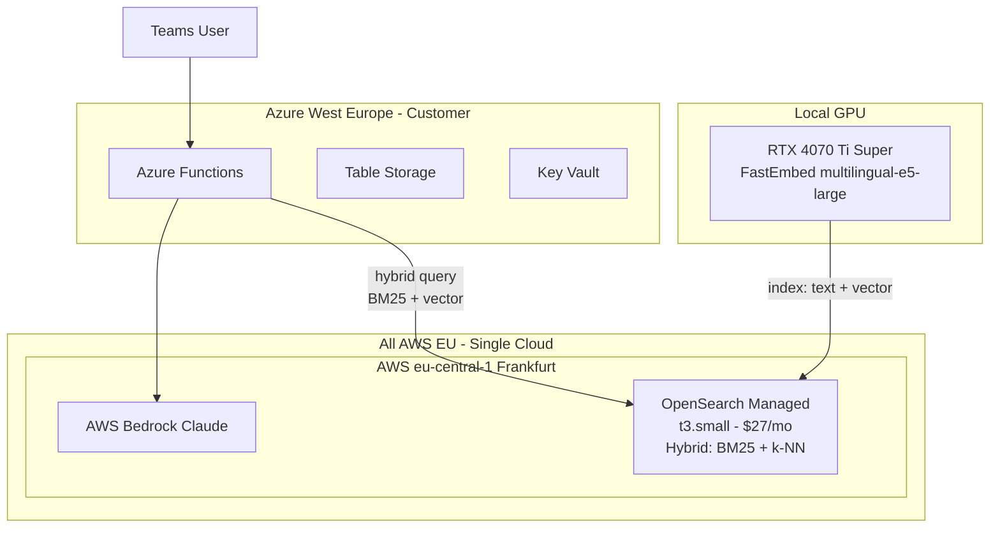

# Vector Database Comparison: Hybrid Search for RAGStone

Comparing OpenSearch (AWS managed), Pinecone EU, and Azure AI Search for hybrid search (BM25 + vector) to improve RAG retrieval quality. Part of the [GDPR Migration Plan](../../infrastructure/docs/GDPR-MIGRATION-PLAN.md).

## Why Hybrid Search Matters

The current system uses **vector-only search** (Pinecone + dense embeddings). This misses exact keyword matches -- for example, if a user asks about "procedure XYZ-123" or a specific Polish term, vector search may not surface the exact document containing that string. Hybrid search combines:

- **BM25 (keyword/lexical):** Exact term matching, great for specific names, codes, and Polish-language morphology
- **k-NN (vector/semantic):** Meaning-based matching, captures synonyms, paraphrases, and context

Research consistently shows hybrid search outperforms either approach alone for RAG.

---

## Option A: AWS OpenSearch (Managed)

### How it works

OpenSearch natively combines BM25 full-text search with k-NN vector search in a single query. You store **both** the raw text and the dense vector for each chunk. At query time, OpenSearch runs BM25 on the text fields and k-NN on the vector field in parallel, then normalizes and combines scores.

**No separate sparse vector generation needed** -- BM25 runs directly on stored text.

### EU Availability

- Frankfurt (`eu-central-1`) and Ireland (`eu-west-1`) -- confirmed available
- Same AWS account as Bedrock -- single cloud, single billing

### Pricing (Managed Cluster)

- **t3.small.search:** ~$26/month (2 vCPU, 2GB RAM) -- sufficient for ~1,500 chunks
- **EBS Storage:** ~$0.10/GB/month (10GB = $1/month)
- **Free tier:** 750 hours/month of t3.small (covers 1 instance for first 12 months)
- **Total: ~$27/month** (vs Pinecone $70/month = **$43/month savings**)

**Warning: Do NOT use OpenSearch Serverless** -- minimum $350/month, overkill for this workload.

### LangChain Integration

Standalone `langchain-opensearch` package available (merged Dec 2024), supports hybrid search with configurable BM25/vector weights:

```python
from langchain_opensearch import OpenSearchVectorSearch

vectorstore = OpenSearchVectorSearch(
    opensearch_url="https://your-opensearch-domain.eu-central-1.es.amazonaws.com",
    index_name="ragstone-docs",
    embedding_function=embeddings,
    http_auth=("admin", "password"),
    engine="nmslib",
    space_type="cosinesimil",
)

docs = vectorstore.similarity_search(query, k=5)
```

### Architecture



### Pros

- **True native hybrid search** -- BM25 + vector in single query, score normalization built-in
- **Cheaper:** ~$27/month vs $70/month Pinecone
- **Single AWS cloud** -- OpenSearch + Bedrock in same account/region
- **No sparse vector generation** -- BM25 runs on stored text automatically
- **Tunable weights** -- adjust BM25 vs vector contribution per query
- **Future-proof** -- supports filters, aggregations, nested fields, analyzers for Polish language

### Cons

- **More operational overhead** -- must manage cluster (updates, backups, security)
- **More complex setup** -- VPC, security groups, IAM, domain configuration
- **Cold starts** -- t3 burstable instances may have latency spikes under load
- **Terraform complexity** -- need AWS provider + OpenSearch resources in addition to Azure
- **Learning curve** -- OpenSearch query DSL, mapping configuration, neural search pipelines

---

## Option B: Pinecone EU + Hybrid Search

### How it works

Pinecone supports hybrid search via **sparse + dense vectors** in a single index. You must generate sparse vectors yourself using BM25 encoding (via `pinecone-text` library) at both index time and query time.

### Hybrid Search Setup

Requires the `pinecone-text` library to generate BM25 sparse vectors:

```python
from pinecone_text.sparse import BM25Encoder

bm25 = BM25Encoder()
bm25.fit(corpus)
sparse_vector = bm25.encode_queries(query)

index.upsert(vectors=[{
    "id": "vec1",
    "values": dense_embedding,
    "sparse_values": sparse_vector,
    "metadata": {...}
}])

results = index.query(
    vector=query_dense,
    sparse_vector=query_sparse,
    top_k=5,
    alpha=0.7  # 70% semantic, 30% keyword
)
```

### Limitations

- **dotproduct metric required** -- only works with dotproduct distance (current index uses cosine)
- **Must generate sparse vectors** -- extra BM25 encoding step at both index and query time
- **Must fit BM25 encoder** on corpus first and persist the fitted model
- **No sparse-only queries** in single hybrid index mode
- **More pipeline complexity** -- manage fitted BM25 model, generate 2 vector types per chunk

### Pricing

- ~$70/month (Standard plan, EU region)

### Pros

- **Simpler operations** -- fully managed, no cluster to maintain
- **Already planned** -- current migration plan uses Pinecone EU
- **Less migration work** -- keep existing Pinecone patterns, just add sparse vectors

### Cons

- **Hybrid search is more manual** -- generate and manage sparse vectors yourself
- **Requires BM25 encoder fitting** -- must train on corpus and serialize/load the model
- **Distance metric change** -- must switch from cosine to dotproduct (index recreation)
- **More expensive** -- $70/month vs $27/month for OpenSearch

---

## Option C: Azure AI Search (Hybrid)

### How it works

Best-in-class hybrid search with native BM25 + vector + optional semantic ranker (re-ranking with a cross-encoder model). Managed service within Azure.

### Pricing

- **Basic tier:** $73/month per Search Unit (minimum)
- **Standard S1:** $245/month -- for production workloads
- **Semantic ranker:** 1,000 free/month, then $1/1,000 requests

### Pros

- **Best hybrid search quality** -- BM25 + vector + semantic re-ranking
- **Already on Azure** -- same cloud as Functions, Storage, Key Vault
- **Built-in document cracking** -- can parse PDFs, DOCX natively

### Cons

- **Most expensive:** $73-245/month minimum
- **Vendor lock-in** on Azure for search
- **Still need embedding model** for vector part

---

## Comparison Summary

| Criteria | OpenSearch (AWS) | Pinecone + Hybrid | Azure AI Search |
|---|---|---|---|
| Hybrid search quality | Native, excellent | Manual sparse vectors | Best (with re-ranker) |
| Monthly cost | ~$27 | ~$70 | ~$73-245 |
| Operational overhead | Medium (manage cluster) | Low (fully managed) | Low (fully managed) |
| EU compliance | Frankfurt/Ireland | Ireland | West Europe |
| Setup complexity | High (VPC, IAM, domain) | Low (add sparse vectors) | Medium |
| Cloud alignment | Same as Bedrock (AWS) | Separate service | Same as Functions (Azure) |
| LangChain integration | Yes (langchain-opensearch) | Yes (langchain-pinecone) | Yes (langchain-azure) |
| Polish language support | Custom analyzers available | BM25Encoder (basic) | Language analyzers built-in |

---

## Recommendation

**AWS OpenSearch Managed** offers the best value for true hybrid search:

1. **Native hybrid search** is significantly simpler than Pinecone's sparse vector approach -- no BM25 encoder fitting, no sparse vector generation, no model serialization
2. **$43/month cheaper** than Pinecone ($27 vs $70)
3. **Single AWS cloud** alongside Bedrock -- simplifies billing, networking, and IAM
4. **Polish language analyzers** can be configured for better BM25 tokenization
5. The operational overhead is manageable for a t3.small instance with a small knowledge base

**However**, if minimal ops is the priority and managing a cluster is not desired, **Pinecone with hybrid search** is the simpler path -- just more expensive and with manual sparse vector management.

---

## Migration Impact if OpenSearch is Chosen

### Files that change (vs Pinecone plan)

- `pinecone-pipeline/pinecone_io.py` -- Replace Pinecone client with OpenSearch client, store text + vector
- `pinecone-pipeline/retrieval_helper.py` -- Update search to use OpenSearch hybrid queries
- `teams-bot/rag/graph.py` -- Replace `PineconeVectorStore` with `OpenSearchVectorSearch`
- `teams-bot/rag/nodes.py` -- Update retriever to use hybrid search
- `teams-bot/config.py` -- Replace `PineconeConfig` with `OpenSearchConfig`
- `teams-bot/requirements.txt` -- Replace `langchain-pinecone` with `langchain-opensearch`, `opensearch-py`
- `infrastructure/` -- Add AWS OpenSearch Terraform resources (domain, access policy, security group)

### What stays the same

- AWS Bedrock Claude (LLM) -- unchanged
- Local GPU embeddings (multilingual-e5-large, 1024 dims) -- unchanged
- Bedrock Titan embeddings for query-time -- unchanged
- Azure Functions, Storage, Key Vault -- unchanged
- All Terraform AWS credential setup -- unchanged
